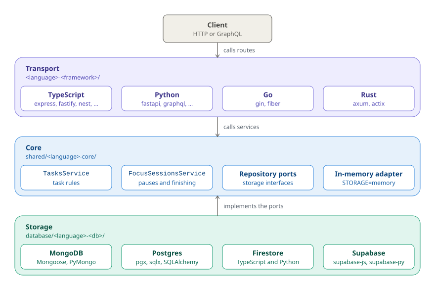

# Architecture

Every implementation of the Cero API serves the same contract, and most of them
share one core per language. This page shows how the pieces fit; each
implementation's own README has an **Architecture** section with its request
flow.

## Layers

<picture>
  <source media="(prefers-color-scheme: dark)" srcset="diagrams/layers-dark.svg">
  
</picture>

Purple is the transport layer, blue the core, teal storage. Arrows point the way
dependencies go: storage depends on the core's ports, never the other way round.

| Layer | Where | Holds |
| --- | --- | --- |
| **Transport** | `<language>-<framework>/` | Routes, validation, error → status code, and the composition root |
| **Core** | `shared/<language>-core/` | Domain rules, `TasksService`, `FocusSessionsService`, the repository ports, an in-memory adapter |
| **Storage** | `database/<language>-<database>/` | One adapter per database, proven by the core's *repository contract* tests |

- **The core knows nothing** about HTTP or databases. It is plain code, unit-tested
  with the in-memory repositories against [`shared/core-test-plan.md`](../shared/core-test-plan.md).
- **A storage adapter** implements the two repository ports (`TaskRepository`,
  `FocusSessionRepository`) for one database and runs the core's repository
  contract suite to prove it.
- **A framework folder** wires one adapter into the core and translates HTTP to
  service calls and errors to status codes. Two frameworks of the same language
  differ only where the frameworks really differ.

Laravel and Phoenix are the only frameworks in their languages, so they use
their framework's own layering: Eloquent models and actions in `php-laravel`,
Ecto contexts in `elixir-phoenix`.

## One endpoint, one service method

Each route maps to exactly one service method (`GET /tasks` → `tasks.list()`,
`PATCH /focus-sessions/pause` → `focusSessions.pauseCurrent({ time })`, …). The
full table, and how the names translate across TypeScript, Python, Go and Rust,
is in [`shared/README.md`](../shared/README.md#one-endpoint-one-service-method).

## Per-language cores

| Core | Package | Used by |
| --- | --- | --- |
| [TypeScript](../shared/typescript-core/README.md#architecture) | `@cero/core` | express, fastify, nest, graphql, firebase, supabase |
| [Python](../shared/python-core/README.md#architecture) | `cero-core` | fastapi, graphql, supabase, firebase |
| [Go](../shared/go-core/README.md#architecture) | `go-core` | gin, fiber |
| [Rust](../shared/rust-core/README.md#architecture) | `cero-core` | axum, actix |
